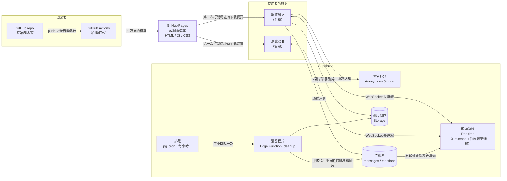
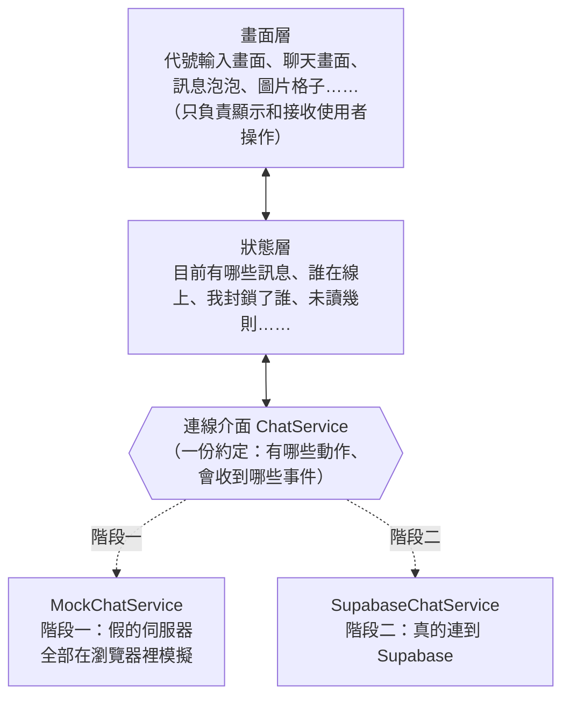
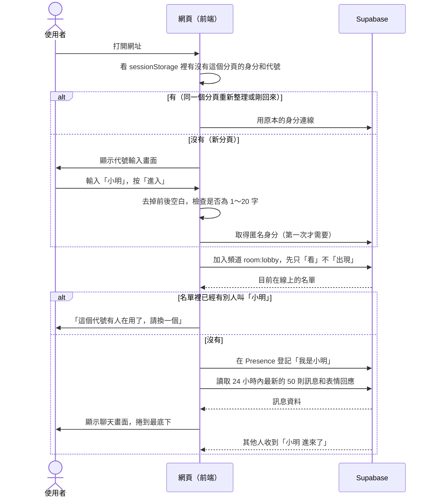
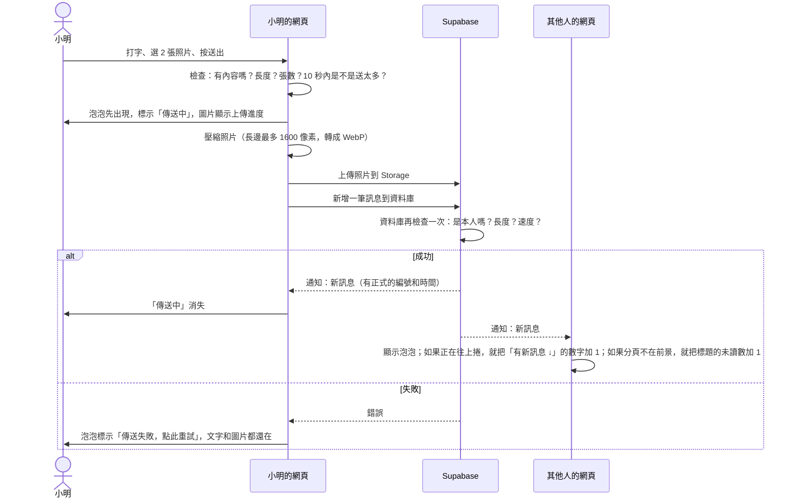
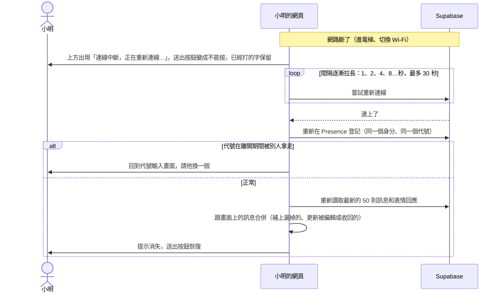
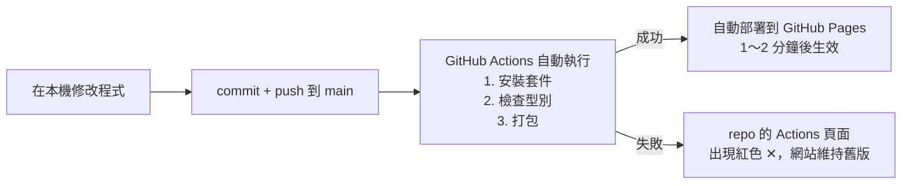

# 匿名聊天室：架構文件

> 這份文件的讀者不需要會寫程式。專有名詞第一次出現時，後面會用「（）」補一句白話解釋。
> 需求的來源是 `docs/requirements.md`，以及之後問答確認的 12 項決定（整理在第 1 節）。

---

## 1. 專案說明與目標

### 這是什麼

一個**不用註冊、不用登入**的網頁聊天室。全世界只有**一間**聊天室，任何人拿到網址，輸入一個代號就能進來聊天。電腦和手機都可以用。

網址預計是：`https://leiii228.github.io/Leiiii/`

### 已經確定的使用者體驗

| # | 項目 | 決定 |
|---|---|---|
| 1 | 進來時看到的歷史訊息 | 最近 50 則（只算 24 小時內的訊息） |
| 2 | 代號重複 | 同一時間在線上的人，代號不能一樣。有人在用的話，請新進來的人換一個 |
| 3 | 下次打開網頁 | 每次都重新輸入代號，不幫忙記 |
| 4 | 長度限制 | 代號 1～20 個字，前後的空白自動去掉。訊息不限長度，但技術上有 20,000 字的保護上限 |
| 5 | 訊息樣式 | 像 LINE：自己的靠右、別人的靠左。時間顯示「10:32」，換日時插一條日期分隔線 |
| 6 | 離開的判定 | 斷線超過 1 分鐘才算離開。分頁沒關的話，回來會自動用原本的代號回到聊天室 |
| 7 | 額外功能 | 網址可以點、分頁標題顯示未讀數、往上捲時有「有新訊息 ↓」按鈕、傳圖片、表情回應 |
| 8 | 圖片 | 用 📎 按鈕選圖，一則最多 9 張，可以附文字。泡泡裡顯示小圖，點一下放大，可以左右滑 |
| 9 | 表情回應 | 任何表情都可以選，每則訊息下面一直有「＋😊」，可以看到是誰按的 |
| 10 | 收回和編輯 | 都可以，但只限同一個分頁還沒關的時候 |
| 11 | 防止有人來亂 | 送訊息有速度限制。每個人可以封鎖別人，只影響自己的畫面 |
| 12 | 保留多久 | 訊息和圖片在 24 小時後自動永久刪除 |

### 目標

1. **階段一**：先做出完整的畫面，放上 GitHub Pages。還沒有真的伺服器，但打開網址就能「玩」到全部功能。
2. **階段二**：接上 Supabase，變成真的多人即時聊天室。
3. 從階段一換到階段二時，**畫面的程式完全不用改**，只要換掉負責連線的那一塊。

---

## 2. 整體架構圖

先說明圖裡的角色：

- **瀏覽器**：使用者手機或電腦上的 Chrome、Safari 等。聊天室的程式全部在這裡執行。
- **GitHub Pages**（GitHub 提供的免費網頁空間，只能放固定不變的檔案）：只負責「把網頁檔案交給瀏覽器」。它不知道誰在聊天，也不存任何訊息。
- **Supabase**（一個雲端服務，提供資料庫、即時連線、檔案儲存等功能，有免費方案）：負責存訊息、存圖片，並且把新訊息即時推送給大家。



重點：

- **GitHub Pages 和 Supabase 之間沒有直接溝通。** 瀏覽器先從 GitHub Pages 下載網頁，之後網頁裡的程式自己連到 Supabase。
- **WebSocket**（一種「電話一直不掛斷」的連線方式）讓 Supabase 可以主動把新訊息推給瀏覽器，不用瀏覽器每隔幾秒去問一次。
- 階段一沒有右邊整個 Supabase 區塊。網頁裡會用一個「假的伺服器」代替它（見第 4 節）。

---

## 3. 技術選擇

### 3.1 前端

**前端**（在使用者瀏覽器裡執行的那一部分程式，也就是畫面和互動）

| 項目 | 選了什麼 | 為什麼 |
|---|---|---|
| 程式語言 | **TypeScript**（JavaScript 的加強版，寫的時候要標明每個資料是什麼格式） | 這個聊天室有很多種資料：訊息、圖片、表情回應、線上名單。TypeScript 會在程式還沒執行時就抓出「格式對不上」的錯誤。第 5 節的通訊約定也可以直接寫成 TypeScript，讓階段一和階段二被迫遵守同一份約定。 |
| 畫面框架 | **React**（一套建立畫面的工具，把畫面拆成一塊一塊的「元件」，資料改變時自動更新畫面） | 這個聊天室的畫面會一直變化：新訊息、表情數字、線上名單、編輯、收回。React 很擅長「資料變了，畫面跟著變」。它也是最多人用的框架，`/frontend-design` 做出來的東西、網路上的教學和現成元件都最多。 |
| 打包工具 | **Vite**（把原始程式整理、壓縮成瀏覽器看得懂的檔案的工具） | 設定最少、速度最快，而且打包出來的就是一般網頁檔案，可以直接放上 GitHub Pages。 |
| 狀態管理 | 不另外裝套件，用 React 內建的功能 | 這裡的資料量不大，多裝一套工具只會增加要學的東西。 |
| 表情選單 | **emoji-picker-element**（現成的表情選擇器） | 決定 9 要求「任何表情都可以選」，自己做完整的表情選單很費工。這個套件小、支援搜尋、手機上也好用。 |
| 圖片壓縮 | 用瀏覽器內建的 Canvas（瀏覽器本身就有的繪圖功能）自己縮圖 | 決定 8 要先在使用者的裝置上壓縮再上傳。不需要額外套件就做得到。 |

**沒有選的：**
- 純 HTML + JavaScript，不用框架：檔案少，但這次的互動很多（編輯、收回、表情、圖片格子、放大檢視），沒有框架的話程式很快會變得很亂。
- Vue、Svelte：也是好選擇，但 React 的資源最多，對之後想找人幫忙或查資料的你最有利。

### 3.2 Supabase 用到的功能

| 功能 | 選了什麼 | 為什麼 |
|---|---|---|
| 使用者身分 | **Anonymous Sign-in**（匿名登入：Supabase 自動發給每個訪客一張隨機的「身分證」，使用者完全不會看到登入畫面） | 決定 10、11 都需要知道「這則訊息是不是你自己的」。如果只靠代號判斷，誰都能冒用別人的代號去收回別人的訊息。匿名身分讓伺服器可以確認「只有發訊息的人能改這則訊息」，使用者卻感覺不到登入。 |
| 身分存放的位置 | 存在瀏覽器的 **sessionStorage**（瀏覽器給「單一分頁」的小抽屜，分頁關掉就清空，重新整理不會清空） | 正好符合決定 3、6、10：分頁沒關就是同一個人，關掉之後就變成新的人。 |
| 存訊息 | **Database**（資料庫，用表格存資料的地方。Supabase 用的是 PostgreSQL） | 決定 1 要讓新來的人看到最近 50 則，決定 10 要能編輯和收回，決定 9 要記錄誰按了表情。這些都需要把資料「存下來」，所以不能只做單純的轉發。 |
| 誰在線上 | **Realtime Presence**（Supabase 即時功能的一部分，專門追蹤「現在誰連著」） | 這正是 Presence 的用途：有人連上或斷線時，所有人都會收到通知。線上名單和「誰進來、誰離開」的提示都靠它。 |
| 新訊息即時出現 | **Realtime Postgres Changes**（資料庫有新增或修改時，Supabase 自動通知所有連著的人） | 訊息一律先寫進資料庫，資料庫再通知大家。這樣「存起來的」和「大家看到的」永遠一致，不會有人看到一則其實沒存成功的訊息。編輯、收回、表情回應也走同一條路。 |
| 圖片 | **Storage**（檔案儲存空間） | 圖片檔案太大，不適合放進資料庫。訊息裡只記錄圖片的位置，圖片本身放在 Storage。 |
| 權限控管 | **RLS，Row Level Security**（資料列層級的權限規則：在資料庫裡寫好「誰可以讀、誰可以改哪一筆」） | 前端的程式誰都能看、誰都能改，所以真正的規則一定要放在伺服器這一端。例如「只能改自己的訊息」、「代號最多 20 字」、「10 秒內最多 5 則」，都由資料庫強制執行。 |
| 24 小時刪除 | **pg_cron**（資料庫內建的鬧鐘，可以定時執行工作）每小時叫一次 **Edge Function**（放在 Supabase 上的一小段伺服器程式） | 刪訊息可以直接在資料庫做，但刪 Storage 裡的圖片檔必須透過 Storage 的正式管道，所以需要一小段伺服器程式。這也是整個專案**唯一**一段在伺服器上執行的自訂程式。 |

**沒有選的：**
- **Realtime Broadcast**（純轉發，不存資料）：速度很快，但新來的人看不到之前的訊息，也沒辦法可靠地做編輯、收回、表情統計。這些需求都需要資料庫，所以不用它來傳訊息。
- **Email 登入或 Google 登入**：需求明確說不要。

---

## 4. 兩個階段

### 4.1 關鍵設計：把「連線」包成可以替換的一塊

整個前端分成三層：



- **介面（interface）**：一份規格書，規定「連線這一塊」必須提供哪些按鈕可以按、會發出哪些通知。內容寫在第 5 節。
- 畫面層和狀態層**只認得這份規格書**，不知道背後是假的還是真的伺服器。
- 階段一寫一個「假伺服器」版本，階段二再寫一個「Supabase」版本。兩個都照同一份規格書，所以可以直接替換。
- 程式啟動時會看設定：有 Supabase 的網址和金鑰就用真的，沒有就用假的。網址後面加上 `?mock=1` 時，強制使用假的（階段二之後還能拿來展示或測試畫面）。

為了讓這個替換真的不痛，有三條規則：

1. **畫面層不能直接碰 Supabase。** 所有 Supabase 相關的程式，只能出現在 `src/chat/supabase/` 這個資料夾裡。
2. **假伺服器要像真的一樣「慢」和「會失敗」。** 例如送訊息要等 0.3 秒才回應，偶爾可以設定成失敗。這樣「傳送中」、「傳送失敗，點此重試」、「重新連線中」這些畫面，在階段一就會做好，不會到階段二才發現少做了。
3. **規則判斷放在共用的地方。** 例如代號 1～20 字、10 秒最多 5 則，寫成一份共用的檢查程式，假伺服器和畫面都用它。階段二時，資料庫會再檢查一次同樣的規則。

### 4.2 階段一：還沒接 Supabase

**要做到的程度：所有畫面和互動都完成，看起來跟真的一樣。**

假伺服器 `MockChatService` 會：

- **模擬其他人**：內建 3～4 個「機器人網友」，例如「路過的貓」、「夜貓子」。它們會隨機進來、離開、聊幾句、對訊息按表情、偶爾傳一張示範圖片、偶爾編輯或收回自己的訊息。這樣一個人打開網頁，也能看到所有功能動起來。
- **同一台電腦開兩個分頁可以互相聊天**：使用瀏覽器內建的 **BroadcastChannel**（讓同一個瀏覽器的不同分頁互相傳話的功能）。在電腦上開兩個分頁、輸入兩個代號，就能測試「重複代號」、「收回」、「封鎖」等需要兩個人的功能。（手機和電腦之間沒辦法互通，那要等階段二。）
- **模擬歷史訊息**：一進來就有一些預先準備好的舊訊息，可以測試「最近 50 則」和日期分隔線。
- **模擬 1 分鐘寬限**：機器人會「斷線 30 秒又回來」（不應該出現提示），也會「斷線超過 1 分鐘」（應該出現離開提示）。
- **模擬斷線**：畫面角落有一個只在示範模式出現的小開關「模擬斷線」，用來測試重新連線的畫面。
- **圖片**：選的圖片只存在你自己的瀏覽器記憶體裡，重新整理就消失。（同一台電腦的另一個分頁也看得到。）

**在 GitHub Pages 上怎麼看：** 照第 12 節的方式部署之後，打開 `https://leiii228.github.io/Leiiii/` 就是示範模式。畫面最上方會有一條小提示：「示範模式：其他人是模擬的，訊息不會被保存」，避免有人以為這是真的聊天室。

### 4.3 階段二：接上 Supabase

改變的地方：

| 項目 | 階段一 | 階段二 |
|---|---|---|
| 連線那一塊 | `MockChatService` | `SupabaseChatService` |
| 其他人 | 機器人和同一台電腦的其他分頁 | 世界各地的真人 |
| 訊息保存 | 重新整理就消失 | 存在資料庫，24 小時後刪除 |
| 圖片 | 存在瀏覽器記憶體 | 上傳到 Supabase Storage |
| 規則檢查 | 只有前端檢查 | 前端檢查一次，資料庫再強制檢查一次 |
| 示範模式提示條 | 有 | 沒有（加上 `?mock=1` 時才會出現） |
| 新增的檔案 | — | `src/chat/supabase/`、`supabase/` 資料夾、`.env.local`（不進 git）、GitHub 的設定值 |
| 畫面層和狀態層 | — | **完全不改** |

階段二的設定步驟（實作時會一步一步帶你做）：

1. 在 supabase.com 建立專案，地區選 **Tokyo（東京）**，離台灣最近，延遲最低。
2. 打開 **Anonymous Sign-ins**。
3. 執行準備好的資料庫設定檔 `supabase/migrations/0001_init.sql`：建立資料表、權限規則、速度限制、Realtime 設定、Storage bucket。
4. 部署清理程式 `cleanup`，並設定每小時執行一次。
5. 把 Supabase 的網址和公開金鑰放到本機的 `.env.local` 和 GitHub 的設定裡（第 8 節）。
6. 重新部署。

---

## 5. 通訊約定

這一節是第 4 節說的「規格書」。假伺服器和 Supabase 版本都必須完全照這裡做。

**JSON**（一種用文字表示資料的通用格式，長得像 `{"名稱": "值"}`）是下面範例使用的格式。**UUID**（一串隨機產生、幾乎不可能重複的編號，例如 `3f2a…`）用來當作每個人、每則訊息的編號。

### 5.1 資料格式

**成員（在線上的人）**
```json
{
  "userId": "3f2a9c1e-…",           // 匿名身分的編號，同一個分頁不會變
  "nickname": "小明",
  "onlineSince": "2026-10-13T10:00:00Z"   // 這次進來的時間（世界標準時間，畫面上會換成台灣時間）
}
```

**訊息**
```json
{
  "id": "b81c…",                     // 訊息編號
  "userId": "3f2a9c1e-…",            // 誰送的
  "nickname": "小明",                // 送出當下的代號
  "text": "大家好 https://example.com",  // 可以是空字串（只傳圖片的時候）
  "images": [
    { "path": "3f2a…/b81c…/0.webp", "width": 1600, "height": 1200 }
  ],                                  // 0～9 張
  "createdAt": "2026-10-13T10:32:05Z",   // 由伺服器決定，不用使用者電腦的時間
  "editedAt": null,                   // 有編輯過的話是編輯時間，畫面顯示「(已編輯)」
  "retracted": false                  // true 時畫面顯示「小明 收回了一則訊息」，文字和圖片已清空
}
```

**表情回應**
```json
{
  "messageId": "b81c…",
  "userId": "7d10…",
  "nickname": "阿華",     // 用來顯示「是誰按的」
  "emoji": "👍"
}
```
同一個人對同一則訊息的同一個表情只能按一次。再按一次就是取消。

### 5.2 前端可以做的動作

| 動作名稱 | 用途 | 可能的失敗原因 |
|---|---|---|
| `join(nickname)` | 用這個代號進入聊天室 | `NICKNAME_TAKEN`（代號有人用了）、`NICKNAME_INVALID`（空白或超過 20 字） |
| `leave()` | 主動離開（關分頁時自動呼叫） | — |
| `sendMessage(text, images)` | 送出訊息 | `RATE_LIMITED`（太快了）、`TOO_LONG`（超過 20,000 字）、`TOO_MANY_IMAGES`（超過 9 張）、`IMAGE_TOO_LARGE`、`UPLOAD_FAILED`、`OFFLINE` |
| `editMessage(id, newText)` | 編輯自己的訊息（只能改文字，不能改圖片） | `NOT_OWNER`（不是你的訊息）、`TOO_LONG`、`OFFLINE` |
| `retractMessage(id)` | 收回自己的訊息 | `NOT_OWNER`、`OFFLINE` |
| `toggleReaction(messageId, emoji)` | 加上或取消表情回應 | `RATE_LIMITED`、`OFFLINE` |

封鎖**不是**連線介面的動作，因為它只影響自己的畫面，伺服器完全不需要知道。

### 5.3 前端會收到的事件

| 事件名稱 | 什麼時候發生 | 內容 |
|---|---|---|
| `connection_changed` | 連線狀態改變 | `connecting`（連線中）／`online`（已連線）／`reconnecting`（重新連線中）／`offline`（已斷線） |
| `history_loaded` | 剛進入或重新連線之後 | 最近 50 則訊息，以及它們的表情回應 |
| `members_synced` | 剛連上時 | 目前所有在線上的人（**不**顯示進出提示） |
| `member_joined` | 有新的人進來 | 成員資料 |
| `member_left` | 有人斷線超過 1 分鐘 | 成員資料 |
| `message_added` | 有新訊息（包括自己的） | 訊息資料 |
| `message_updated` | 有訊息被編輯或收回 | 訊息資料（新版本） |
| `reaction_added` | 有人按了表情 | 表情回應資料 |
| `reaction_removed` | 有人取消表情 | 表情回應資料 |
| `kicked_nickname_conflict` | 很少見：兩個人幾乎同時用同一個代號進來，比較晚的那個人會收到這個事件 | — |

**1 分鐘寬限要由誰處理？** 由連線那一塊處理。Supabase 的 Presence 一斷線就會通知「某人離開了」，`SupabaseChatService` 收到後先等 60 秒。60 秒內同一個 `userId` 回來的話，就當作沒發生過。超過 60 秒才對畫面發出 `member_left`。這樣畫面層完全不用知道寬限這件事，假伺服器也照同樣的方式模擬。

### 5.4 對應到 Supabase 的名稱（階段二）

| 約定 | Supabase 這一端 |
|---|---|
| 聊天室的頻道 | Realtime 頻道名稱 `room:lobby` |
| 成員 | Presence 的內容 `{ userId, nickname, onlineSince }`，用 `userId` 當作識別 |
| 訊息 | 資料表 `messages`，欄位：`id, user_id, nickname, body, images, created_at, edited_at, retracted_at` |
| 表情回應 | 資料表 `reactions`，欄位：`message_id, user_id, nickname, emoji, created_at`，「訊息＋人＋表情」不能重複 |
| 圖片 | Storage bucket `chat-images`，路徑為 `{userId}/{messageId}/{序號}.webp` |
| `message_added`／`message_updated` | `messages` 表的 INSERT／UPDATE 通知 |
| `reaction_added`／`reaction_removed` | `reactions` 表的 INSERT／DELETE 通知 |

資料庫的欄位用英文小寫加底線，前端用駝峰式（`createdAt`），兩者的轉換只在 `SupabaseChatService` 裡做。

---

## 6. 資料流

### 6.1 進入聊天室



補充：

- 比較代號時，英文不分大小寫，全形和半形視為相同（「Ming」和「ｍｉｎｇ」算重複）。
- 兩個人在同一秒用同一個代號進來時，兩邊都可能檢查通過。所以登記之後還會再檢查一次：如果發現有人同名、而且比自己早進來，自己就退出，回到代號輸入畫面（`kicked_nickname_conflict`）。
- 正在 1 分鐘寬限期裡的人，Presence 已經看不到他了，所以他的代號**可能被別人拿走**。這時他回來會看到「你的代號在你離開時被使用了，請換一個」（決定 6）。

### 6.2 送出訊息



編輯、收回、表情回應走同一個模式：先改自己的畫面（看起來很快），再請伺服器確認，失敗的話就把畫面改回去並顯示提示。收回時，也會把那則訊息的圖片從 Storage 刪掉。

### 6.3 離開

| 情況 | 會發生什麼事 |
|---|---|
| 關掉分頁、關掉瀏覽器 | 連線中斷。Presence 通知其他人，其他人的網頁等 60 秒後顯示「小明 離開了」，並把他從線上名單拿掉。sessionStorage 被清空，這個身分就作廢了。 |
| 手機切到別的 App、螢幕關掉 | 手機可能會暫停網頁，連線就斷了。其他人的網頁開始等 60 秒。60 秒內回來的話，其他人什麼都不會看到。 |
| 超過 60 秒才回來 | 其他人已經看到「小明 離開了」。小明的網頁會自動重新連線，用原本的身分和代號重新登記，其他人看到「小明 進來了」。 |
| 等待的 60 秒內 | 線上名單上的小明會**暫時保留**，代號旁邊可以顯示一個淡淡的「暫離」狀態（要不要顯示由 /design 決定）。 |

注意：60 秒是在**每個人自己的網頁**上計算的。每個人看到「離開了」的時間可能差個一兩秒，這是正常的。

### 6.4 斷線重連



另外，手機把網頁切回前景時（瀏覽器會發出「分頁又看得到了」的通知），網頁會主動檢查連線並重新讀取一次，不等到發現斷線才處理。

---

## 7. 畫面清單

這裡只規定**有什麼、會怎麼動**。顏色、字型、排版、動畫交給 /design。

### 7.1 代號輸入畫面

| 元素 | 行為 |
|---|---|
| 聊天室名稱和一句說明 | 例如「匿名聊天室：輸入代號就能開始聊天，訊息 24 小時後自動消失」 |
| 目前在線人數 | 「現在有 5 個人在聊天」。階段一顯示模擬的人數 |
| 代號輸入框 | 打開畫面時游標自動放在這裡（手機上不自動跳出鍵盤，以免擋住畫面）。顯示字數「3 / 20」。超過 20 字時不能再打 |
| 「進入」按鈕 | 去掉空白後沒有字的話不能按。按下後顯示「進入中…」，避免重複點擊。按 Enter 等於按這個按鈕 |
| 錯誤訊息 | 顯示在輸入框下方：「這個代號有人在用了，請換一個」、「你的代號在你離開時被使用了，請換一個」、「連不上伺服器，請稍後再試」 |
| 示範模式提示條 | 只在示範模式出現 |

### 7.2 聊天畫面

整體排列：**電腦**是左邊聊天區、右邊線上名單。**手機**是整頁都給聊天區，線上名單收在上方的「👥 5」按鈕裡，點了才打開。

**上方列**

| 元素 | 行為 |
|---|---|
| 聊天室名稱 | — |
| 線上人數「👥 5」 | 手機上點了會打開線上名單 |
| 連線狀態 | 正常時不顯示。斷線時出現「連線中斷，正在重新連線…」 |
| 「離開」按鈕 | 確認後回到代號輸入畫面，身分作廢（等於關掉分頁再重開） |

**線上名單**

| 元素 | 行為 |
|---|---|
| 每個人的代號 | 自己排在最上面，標示「（你）」 |
| 暫離狀態 | 斷線未滿 60 秒的人，可以顯示得比較淡 |
| 每個人旁邊的「⋯」 | 選項：「封鎖」／「解除封鎖」。自己的旁邊沒有這個按鈕 |

**訊息區**

| 元素 | 行為 |
|---|---|
| 日期分隔線 | 第一則訊息上面，以及每次換日的地方，插入「10/13（一）」 |
| 系統提示 | 「小明 進來了」、「小明 離開了」，置中顯示的小字。只顯示你在聊天室期間發生的事，不會出現在歷史訊息裡 |
| 別人的訊息泡泡 | 靠左。泡泡上方是代號，旁邊是時間「10:32」。同一個人連續送的訊息，只在第一則顯示代號 |
| 自己的訊息泡泡 | 靠右，不顯示代號 |
| 訊息文字 | 保留換行。網址會變成可以點的連結，用新分頁打開。超過約 15 行的訊息會先折起來，下面有「顯示全部」 |
| 「(已編輯)」 | 編輯過的訊息，時間旁邊顯示 |
| 收回的訊息 | 原位置變成「小明 收回了一則訊息」。自己收回的顯示「你收回了一則訊息」 |
| 圖片格子 | 1 張時顯示較大，2～9 張排成格子。圖片還沒載入時，先顯示同樣比例的灰色框，避免畫面跳動 |
| 表情回應列 | 泡泡下方顯示「👍 3 ❤️ 1」，你按過的那個會特別標示。點一下就加入或取消。電腦上滑鼠移過去、手機上長按，會列出按的人的代號 |
| 「＋😊」按鈕 | 每則訊息下面一直都有，點了打開完整的表情選單（可以搜尋）。收回的訊息上沒有這個按鈕 |
| 自己訊息的「⋯」 | 選項：「編輯」、「收回」。收回前要確認一次。只有同一個分頁送的訊息才有這個按鈕 |
| 「傳送中」／「傳送失敗，點此重試」 | 顯示在自己的泡泡旁邊 |
| 被封鎖的人的訊息 | 整則不顯示。他的表情回應不計入數字。他的進出提示也不顯示 |

**「有新訊息 ↓」按鈕**

| 情況 | 行為 |
|---|---|
| 你在最底下附近 | 新訊息來的時候自動捲到最底下，按鈕不出現 |
| 你往上捲在看舊訊息 | 新訊息來的時候**不**自動捲動，右下角出現「有 3 則新訊息 ↓」，點了捲到最底下 |
| 你自己送出訊息 | 一定捲到最底下 |

**輸入區**

| 元素 | 行為 |
|---|---|
| 📎 按鈕 | 打開選檔畫面（手機上可以選相簿或拍照）。可以一次選很多張，總數超過 9 張時只收前 9 張，並提示 |
| 圖片預覽列 | 已選的圖片顯示成小圖，每張右上角有「✕」可以移除 |
| 文字輸入框 | 會隨著內容變高，最多約 6 行，再多就在框裡捲動。電腦上 Enter 是送出，Shift+Enter 是換行。手機上 Enter 是換行，要按送出按鈕 |
| 送出按鈕 | 沒有文字也沒有圖片時不能按。斷線時不能按 |
| 速度限制提示 | 10 秒內送超過 5 則時，顯示「請慢一點」，並在幾秒後恢復 |
| 編輯模式 | 按了「編輯」之後，輸入框上方出現「正在編輯訊息 ✕」，輸入框填入原本的文字，送出按鈕變成「儲存」 |

**分頁標題**

| 情況 | 標題 |
|---|---|
| 你正在看這個分頁 | 「匿名聊天室」 |
| 你切到別的分頁時有人傳訊息 | 「(3) 匿名聊天室」。被封鎖的人的訊息不算。回到這個分頁時，數字就清除 |

### 7.3 圖片放大檢視

| 元素 | 行為 |
|---|---|
| 大圖 | 佔滿畫面。電腦可以按左右鍵切換，手機可以左右滑 |
| 「2 / 5」 | 目前是第幾張 |
| 關閉 | 按 ✕、按 Esc、點圖片外面，或手機上往下滑，都可以關閉 |

### 7.4 表情選單

完整的表情清單，上面有搜尋框，最上面一排是「最近使用」。電腦上是浮在按鈕旁的小視窗，手機上從下方滑出來。

---

## 8. 金鑰

**金鑰**（一串很長的密碼，用來證明「我有權限使用這個服務」）是這個專案最容易出錯的地方。原則只有一條：**放進前端的東西，全世界都看得到。** 因為網頁程式會被下載到每個訪客的瀏覽器裡，任何人按 F12 都看得到。

### 8.1 這個專案會用到的金鑰

| 名稱 | 長什麼樣子 | 用途 | 可以公開嗎 | 放在哪裡 |
|---|---|---|---|---|
| **Project URL** | `https://xxxx.supabase.co` | 你的 Supabase 專案網址 | ✅ 可以 | 前端（透過環境變數，見下面） |
| **Publishable key**（公開金鑰，舊版叫 anon key） | `sb_publishable_…` | 讓前端可以連到 Supabase。它本身權限很小，能做什麼完全由 RLS 規則決定 | ✅ 可以，本來就是設計來放在網頁裡的 | 前端（透過環境變數） |
| **Secret key**（秘密金鑰，舊版叫 service_role key） | `sb_secret_…` | 擁有**全部權限**，可以無視 RLS 讀、改、刪任何資料 | ❌ **絕對不行** | 只給清理程式用。Supabase 會自動提供給 Edge Function，**你不需要把它複製到任何地方** |
| **資料庫密碼** | 建立專案時你自己設定的 | 直接連進資料庫 | ❌ 絕對不行 | 只放在你的密碼管理工具裡。這個專案的程式不會用到它 |
| **CLEANUP_SECRET** | 一串自己產生的亂碼 | 確認「呼叫清理程式的是我們自己的排程」，不是路人 | ❌ 不行 | Supabase 的 Edge Function Secrets，以及 Supabase Vault（資料庫內建的保險箱） |
| **Supabase Access Token**（只有使用 Supabase 的命令列工具時才需要） | `sbp_…` | 讓你電腦上的工具代替你操作 Supabase | ❌ 不行 | 只放在你自己的電腦上，工具會自己保管 |

**為什麼 publishable key 公開了也沒關係？** 它就像大樓的大門：任何人都可以走進大廳，但每扇房門都有自己的鎖（RLS 規則）。這個專案的規則是：

- 只能讀 24 小時內的訊息。
- 只能新增 `user_id` 是自己的訊息。
- 只能修改或收回自己的訊息，而且只能改文字和收回狀態，不能改時間、代號、作者。
- 只能新增或刪除自己的表情回應。
- 只能把圖片上傳到自己的資料夾 `{自己的 userId}/…`，只能刪自己資料夾裡的圖片。
- 不能刪除任何訊息（真正的刪除只有清理程式能做）。

### 8.2 怎麼產生

| 名稱 | 產生方式 |
|---|---|
| Project URL、Publishable key、Secret key | 建立 Supabase 專案時自動產生。在 Supabase 控制台的 **Project Settings → API Keys** 可以看到 |
| 資料庫密碼 | 建立專案時，用 Supabase 頁面上的「Generate a password」按鈕產生，然後存進密碼管理工具 |
| CLEANUP_SECRET | 用密碼管理工具產生一組 40 字以上的隨機密碼即可 |

### 8.3 放在哪裡

**環境變數**（不寫在程式碼裡，而是在程式「打包」或「執行」時才從外面放進去的設定值）是這裡的主角。

```
本機開發時：
  專案根目錄/.env.local        ← 不會進 git
    VITE_SUPABASE_URL=https://xxxx.supabase.co
    VITE_SUPABASE_PUBLISHABLE_KEY=sb_publishable_xxxx

部署到 GitHub Pages 時：
  GitHub repo → Settings → Secrets and variables → Actions → Variables
    VITE_SUPABASE_URL
    VITE_SUPABASE_PUBLISHABLE_KEY
  （打包時 GitHub Actions 會讀取這兩個值，放進網頁裡）

Supabase 上（伺服器端）：
  Edge Function Secrets：CLEANUP_SECRET
  Vault：CLEANUP_SECRET（讓排程呼叫清理程式時帶上）
  Secret key：Supabase 自動提供給 Edge Function，不需要手動設定
```

⚠️ **最重要的一條：** Vite 會把所有 `VITE_` 開頭的設定**放進網頁裡**，所以 `VITE_` 開頭的設定只能放可以公開的東西。**永遠不要建立 `VITE_SUPABASE_SECRET_KEY` 這種東西。**

### 8.4 怎麼避免被 commit 到 GitHub

**commit**（把目前的檔案狀態存成一個版本，push 之後就會上傳到 GitHub）一旦做了，就算之後刪掉，舊版本裡還是找得到。所以要在**事前**擋住：

1. **`.gitignore`**（一份清單，列在裡面的檔案 git 會假裝看不到）裡寫上：
   ```
   .env
   .env.*
   !.env.example
   supabase/.temp/
   ```
   `.env.example` 是例外：它只放「欄位名稱」，不放真的值，用來告訴別人需要設定哪些東西。
2. **開啟 GitHub 的 Secret scanning 和 Push protection**（GitHub 會自動檢查你上傳的內容，發現像金鑰的東西就擋下來）：repo → Settings → Code security。公開的 repo 可以免費使用。Supabase 的 secret key 在它能辨識的格式清單裡。
3. **程式碼裡不寫任何金鑰。** 程式只會讀取環境變數。
4. **萬一秘密金鑰被 commit 了**：不要只是刪掉檔案。馬上到 Supabase 控制台把那把金鑰**作廢並重新產生**（API Keys 頁面可以直接新增一把、刪掉舊的），然後再處理 git 的記錄。

---

## 9. 安全與限制

### 9.1 別人可能送進來的奇怪東西

這個聊天室任何人都能進來，而且**前端的檢查都可以被繞過**（懂程式的人可以不透過網頁，直接呼叫 Supabase）。所以每一項都分成「前端擋」（為了好用，給正常使用者即時提示）和「伺服器擋」（真正的防線）。

| 奇怪的東西 | 可能造成的問題 | 前端怎麼擋 | 伺服器怎麼擋 |
|---|---|---|---|
| 訊息裡藏程式碼，例如 `<script>…</script>` | **XSS**（跨站腳本攻擊：讓別人的瀏覽器執行壞人寫的程式，例如偷走別人的身分） | 所有文字一律當成「純文字」顯示，絕對不當成網頁原始碼來處理（React 預設就是這樣，而且專案規定不准使用 React 的「直接插入原始碼」功能） | — |
| 偽裝成連結的程式，例如 `javascript:…` | 點了會執行程式 | 只有 `http://` 和 `https://` 開頭的才變成連結。連結一律用新分頁打開，並切斷新分頁和聊天室之間的關聯 | — |
| 代號裡有看不見的字元、會把文字方向倒過來的特殊字元、一堆空白 | 假冒別人的代號（例如「小明」和「小明＋隱形字元」看起來一樣） | 移除控制字元、零寬字元、文字方向控制字元，去掉前後空白，統一字元的寫法後再算字數 | 資料庫限制代號長度必須是 1～20 字 |
| 超長訊息（一次貼幾 MB 的文字） | 塞爆資料庫，拖慢所有人的畫面 | 超過 20,000 字不能送出並提示。長訊息先折起來 | 資料庫限制 `body` 最多 20,000 字 |
| 洗版（一秒送幾十則） | 聊天室無法使用 | 10 秒內超過 5 則就顯示「請慢一點」 | 資料庫在新增訊息前檢查：同一個人 10 秒內已經有 5 則的話，就拒絕 |
| 狂按表情 | 洗通知 | 同一個按鈕連續點擊時，只處理最後一次 | 「同一人、同一則訊息、同一個表情」不能重複。另外限制同一個人每 10 秒最多 20 次表情操作 |
| 冒充別人的身分改訊息 | 收回或竄改別人的話 | 只在自己的訊息上顯示「⋯」 | RLS：只能改 `user_id` 等於自己的訊息，而且不能改作者、代號、時間 |
| 超過 9 張圖片 | — | 只收前 9 張 | 資料庫限制 `images` 最多 9 筆 |
| 超大圖片、假裝成圖片的其他檔案 | 吃光儲存空間，或藏惡意內容 | 只接受 JPEG、PNG、WebP、GIF、HEIC。全部重新繪製成 WebP（重新繪製會順便清掉照片裡的拍攝地點等資訊） | Storage bucket 限制：單檔最大 5 MB，只接受 `image/webp`、`image/jpeg`、`image/png`、`image/gif`。**不接受 SVG**，因為 SVG 裡面可以藏程式 |
| 圖片位置指到別的網站 | 讓所有人的瀏覽器去連壞人的網站（可以藉此收集別人的 IP） | 只顯示**我們自己 Storage** 網址底下的圖片 | 資料庫檢查圖片路徑必須是 `{作者的 userId}/…` 的格式 |
| GIF 動畫 | 壓縮會讓動畫消失 | GIF 不壓縮，保留原檔，但必須小於 5 MB | 同上 |
| 大量建立匿名身分（每次都換一個身分來繞過速度限制） | 繞過「每人」的限制 | — | Supabase 預設限制同一個 IP **每小時最多建立 30 個匿名身分**。如果之後真的有人在洗，可以再加上 Cloudflare Turnstile（一種不用點圖片的「確認你是人類」驗證） |
| 不雅的文字或圖片 | 內容問題 | 每個人都可以封鎖 | 這一版不做內容審查（見第 10 節） |

### 9.2 免費方案的上限

> 以下數字是寫這份文件時的資料，各服務可能調整，**請以官網為準**：Supabase 定價頁 <https://supabase.com/pricing>、GitHub Pages 文件 <https://docs.github.com/pages>。

**Supabase 免費方案**

| 項目 | 上限（約） | 對這個專案的影響 |
|---|---|---|
| 同時連線人數（Realtime） | 200 人 | 第 201 個人會連不上。小型聊天室很夠用 |
| Realtime 訊息數 | 每月 200 萬則 | 每個人送一則訊息，伺服器要推給所有在線上的人，所以會被乘上人數。100 人同時在線、每人送 1 則，就會用掉約 1 萬則 |
| 資料庫空間 | 500 MB | 有 24 小時清理的話，幾乎不可能用完 |
| 檔案儲存空間 | 1 GB | 圖片壓縮到每張約 200～400 KB，大約可以存 3,000 張。有 24 小時清理，一般使用很夠 |
| 流量（下載） | 每月約 5 GB | **最可能先用完的一項。** 每個人看每張圖都算流量。100 個人每人看 50 張 300 KB 的圖就是 1.5 GB。這也是為什麼圖片一定要壓縮 |
| 每月活躍使用者（MAU） | 5 萬 | 匿名身分也算。每開一個新分頁就是一個新身分，所以清理程式也會順便刪掉建立超過 7 天的匿名身分 |
| Edge Function 呼叫次數 | 每月 50 萬次 | 清理程式每小時一次，一個月約 720 次，完全不用擔心 |
| **閒置暫停** | 連續 7 天沒有任何使用，專案會被暫停 | 暫停後網頁會連不上，要到 Supabase 控制台按「恢復」。很久沒人用時要記得這件事 |
| 免費專案數量 | 2 個 | — |

**GitHub Pages**

| 項目 | 上限（約） | 影響 |
|---|---|---|
| repo 必須是公開的（免費帳號） | — | 程式碼大家都看得到。這也是為什麼**金鑰絕對不能放進 repo** |
| 網站大小 | 1 GB | 這個網站只有幾 MB |
| 每月流量 | 100 GB（建議值） | 很夠用 |
| 部署次數 | 每小時 10 次（建議值） | 一般不會碰到 |

---

## 10. 這一版刻意不做的事

| 不做的事 | 為什麼 |
|---|---|
| 註冊、登入、帳號 | 需求明確說不要。匿名身分在背後運作，使用者感覺不到 |
| 多個聊天室、私訊 | 需求是「所有人在同一個聊天室」 |
| 「誰正在輸入…」 | 決定 7 沒有選 |
| 拖曳圖片、貼上圖片 | 決定 8 只選了 📎 按鈕。之後要加很容易，因為上傳的流程是同一套 |
| 影片、檔案、語音 | 很吃儲存空間和流量，免費方案撐不住 |
| 記住代號、跨分頁或跨裝置是同一個人 | 決定 3 要每次重新輸入。這也代表收回、編輯、封鎖都只在同一個分頁裡有效 |
| 載入超過 50 則的舊訊息 | 決定 1 只要最近 50 則 |
| 管理員、踢人、刪別人的訊息 | 決定 11 選了自動限制加上個人封鎖，不選管理員。要做管理員就要多一套「管理員怎麼證明自己」的機制，複雜度會增加很多 |
| 自動過濾髒話或不雅圖片 | 準確的過濾需要付費服務或大量規則。目前靠個人封鎖處理 |
| 檢舉功能 | 沒有管理員的話，檢舉了也沒有人處理 |
| 封鎖在關掉分頁後還記得 | 被封鎖的人重新進來就是新的身分，記住舊身分也沒有用 |
| 推播通知、提示音 | 決定 7 只選了分頁標題的未讀數。推播需要使用者授權，也需要額外的伺服器設定 |
| 已讀、已讀人數 | 沒有要求，在匿名聊天室裡意義也不大 |
| 回覆某一則訊息（引用） | 沒有要求。資料格式之後可以加上「回覆哪一則」的欄位，不影響現有的資料 |
| 斷線時先打好、恢復後自動送出 | 斷線時不能送出，但打好的文字會保留。自動補送容易造成重複的訊息 |
| 搜尋訊息 | 只有 50 則，自己捲一下就看得到 |
| 多國語言 | 目前只有中文介面 |
| 深色模式 | 不在這份文件的範圍，交給 /design 決定 |

---

## 11. repo 的資料夾結構

```
Leiiii/
├─ docs/
│  ├─ requirements.md          需求
│  └─ architecture.md          這份文件
│
├─ .github/
│  └─ workflows/
│     └─ deploy.yml            GitHub Actions：push 到 main 時自動打包並部署到 Pages
│
├─ public/                     不需要處理、直接複製的檔案（網站小圖示、示範用的圖片）
│
├─ src/                        前端的原始程式
│  ├─ main.tsx                 程式的入口
│  ├─ App.tsx                  決定現在顯示哪個畫面
│  │
│  ├─ chat/                    ── 連線那一塊 ──
│  │  ├─ types.ts              第 5 節的資料格式（成員、訊息、表情回應）
│  │  ├─ ChatService.ts        第 5 節的規格書（有哪些動作、哪些事件）
│  │  ├─ createChatService.ts  依照設定決定用假的還是真的
│  │  ├─ mock/                 階段一：假伺服器
│  │  │  ├─ MockChatService.ts
│  │  │  ├─ bots.ts            機器人網友的行為
│  │  │  └─ seedMessages.ts    預先準備的歷史訊息
│  │  └─ supabase/             階段二：唯一可以出現 Supabase 程式的地方
│  │     ├─ client.ts          建立連線（讀環境變數、身分存在 sessionStorage）
│  │     └─ SupabaseChatService.ts
│  │
│  ├─ state/                   狀態層：訊息清單、線上名單、封鎖清單、未讀數
│  │
│  ├─ screens/                 整頁的畫面
│  │  ├─ NicknameScreen.tsx    代號輸入畫面
│  │  └─ ChatScreen.tsx        聊天畫面
│  │
│  ├─ components/              畫面上的零件
│  │  ├─ TopBar.tsx
│  │  ├─ MemberList.tsx        線上名單
│  │  ├─ MessageList.tsx       訊息區（含自動捲動和「有新訊息 ↓」）
│  │  ├─ MessageBubble.tsx
│  │  ├─ DateDivider.tsx
│  │  ├─ SystemNotice.tsx      進來、離開的提示
│  │  ├─ ImageGrid.tsx
│  │  ├─ Lightbox.tsx          圖片放大檢視
│  │  ├─ ReactionBar.tsx
│  │  ├─ EmojiPicker.tsx
│  │  ├─ Composer.tsx          輸入區
│  │  └─ DemoBanner.tsx        示範模式提示條
│  │
│  ├─ lib/                     共用的小工具
│  │  ├─ validation.ts         代號、訊息、圖片的規則（第 9 節）
│  │  ├─ rateLimit.ts          前端的速度限制
│  │  ├─ linkify.ts            把網址變成連結
│  │  ├─ compressImage.ts      圖片壓縮
│  │  ├─ time.ts               時間和日期的顯示格式
│  │  └─ unreadTitle.ts        分頁標題的未讀數
│  │
│  └─ styles/                  樣式（/design 的成果放這裡）
│
├─ supabase/                   ── 階段二才會出現 ──
│  ├─ migrations/
│  │  └─ 0001_init.sql         資料表、RLS、速度限制、Storage 設定、排程
│  └─ functions/
│     └─ cleanup/
│        └─ index.ts           每小時清理：24 小時前的訊息和圖片、7 天前的匿名身分
│
├─ index.html
├─ package.json                專案用了哪些套件、有哪些指令
├─ tsconfig.json               TypeScript 的設定
├─ vite.config.ts              Vite 的設定（包含 GitHub Pages 的子路徑 /Leiiii/）
├─ .env.example                需要設定哪些環境變數（只有名稱，沒有值）
├─ .gitignore
└─ README.md                   怎麼在本機執行、怎麼部署
```

---

## 12. 部署到 GitHub Pages 的方式

使用 **GitHub Actions**（GitHub 內建的自動化工具：每次 push 程式碼，它就會在 GitHub 的電腦上幫你打包並上線）。你不需要在自己的電腦上打包，也不需要把打包好的檔案放進 repo。

### 第一次設定（只做一次）

1. repo → **Settings → Pages → Build and deployment → Source** 選 **GitHub Actions**。
2. 確認 `vite.config.ts` 裡的網站路徑設成 `/Leiiii/`。因為網址是 `leiii228.github.io/Leiiii/`，不是網域的根目錄，路徑設錯的話，打開網頁會是一片空白。
3. （階段二才需要）repo → **Settings → Secrets and variables → Actions → Variables** 新增 `VITE_SUPABASE_URL` 和 `VITE_SUPABASE_PUBLISHABLE_KEY`。
4. repo → **Settings → Code security** 開啟 Secret scanning 和 Push protection。

### 之後每次更新



- 部署進度可以在 repo 的 **Actions** 分頁看到。
- 打包失敗時，網站會**維持上一個成功的版本**，不會壞掉。
- 階段一沒有設定 Supabase 的環境變數，所以打包出來自動就是示範模式。階段二設定好環境變數之後再 push 一次，就會自動變成真的聊天室，**不用改任何部署設定**。

### Supabase 這一端的更新

資料庫設定（`supabase/migrations/`）和清理程式（`supabase/functions/`）**不會**透過 GitHub Pages 部署。它們在階段二由我們手動套用一次：可以在 Supabase 控制台的 SQL Editor 貼上執行，或用 Supabase 的命令列工具。這部分很少需要改，所以這一版不做自動化。

---

## 13. 驗證清單

每一項都寫成「做了什麼 → 應該看到什麼」。全部打勾才算完成。

### 13.1 階段一（示範模式，在 GitHub Pages 上測）

**部署**
- [ ] 打開 `https://leiii228.github.io/Leiiii/` → 看到代號輸入畫面，不是一片空白
- [ ] 最上方有「示範模式」提示條
- [ ] 改一個字、push → 2 分鐘內網站更新
- [ ] 重新整理任何頁面都不會出現 404

**代號**
- [ ] 什麼都不輸入，或只輸入空白 → 「進入」不能按
- [ ] 輸入 21 個字 → 打不進去，字數顯示「20 / 20」
- [ ] 輸入「　小明　」（前後有全形空白）→ 進去之後顯示「小明」
- [ ] 輸入機器人的代號（例如「路過的貓」）→ 顯示「這個代號有人在用了」
- [ ] 電腦開兩個分頁，都輸入「小明」→ 第二個分頁被拒絕
- [ ] 重新整理分頁 → 直接回到聊天室，代號不變
- [ ] 關掉分頁再打開 → 要重新輸入代號

**歷史訊息與顯示**
- [ ] 一進來就看到預先準備的訊息，最多 50 則，而且已經捲到最底下
- [ ] 有日期分隔線，時間顯示成「10:32」的格式
- [ ] 自己的訊息靠右、別人的靠左。同一人連續送的訊息只顯示一次代號

**送訊息**
- [ ] 送出文字 → 先出現「傳送中」，然後消失
- [ ] 電腦 Enter 送出、Shift+Enter 換行。手機 Enter 換行
- [ ] 訊息裡的 `https://example.com` 可以點，用新分頁打開
- [ ] 送出 `<b>粗體</b><script>alert(1)</script>` → 原封不動地顯示成文字，不會變粗，也不會跳出視窗
- [ ] 送出 `javascript:alert(1)` → 不會變成連結
- [ ] 貼上一段很長的文字 → 送得出去，在畫面上折起來，有「顯示全部」
- [ ] 10 秒內連送 6 則 → 第 6 則出現「請慢一點」
- [ ] 把假伺服器設成「失敗」→ 出現「傳送失敗，點此重試」，點了可以重送

**圖片**
- [ ] 按 📎 選 3 張 → 預覽列出現 3 張，可以用 ✕ 移除
- [ ] 選 12 張 → 只收 9 張，並出現提示
- [ ] 送出圖片加文字 → 泡泡裡顯示格子和文字
- [ ] 點圖片 → 放大。可以左右切換，可以用 Esc 或往下滑關閉
- [ ] 手機上 📎 可以選相簿，也可以拍照
- [ ] 選一個 SVG 或 PDF → 被拒絕

**表情回應**
- [ ] 按「＋😊」→ 打開完整的表情選單，可以搜尋
- [ ] 選 👍 → 下面出現「👍 1」並標示是自己按的。再點一次就取消
- [ ] 機器人也按 👍 → 變成「👍 2」。滑鼠移上去（手機上長按）會列出兩個人的代號

**編輯與收回**
- [ ] 編輯自己的訊息 → 內容更新，出現「(已編輯)」
- [ ] 收回自己的訊息 → 變成「你收回了一則訊息」。另一個分頁看到的是「小明 收回了一則訊息」
- [ ] 別人的訊息上沒有「⋯」
- [ ] 重新整理之後，之前送的訊息還能編輯（同一個分頁）

**線上名單與進出**
- [ ] 電腦上線上名單在右邊。手機上點「👥」才打開
- [ ] 機器人進來 → 出現「○○ 進來了」，名單更新
- [ ] 機器人斷線 30 秒後回來 → **沒有**任何提示
- [ ] 機器人斷線超過 60 秒 → 出現「○○ 離開了」
- [ ] 剛進聊天室時，已經在線上的人**不會**跳出「進來了」

**封鎖**
- [ ] 封鎖一個機器人 → 它的訊息、表情、進出提示都不再出現，表情數字也不算它
- [ ] 解除封鎖 → 恢復顯示
- [ ] 另一個分頁不受影響

**捲動與未讀**
- [ ] 在最底下時，新訊息自動捲到底
- [ ] 往上捲時，新訊息不會強迫捲動，出現「有 N 則新訊息 ↓」，點了回到底下
- [ ] 自己送出訊息時，一定捲到底
- [ ] 切到別的分頁，機器人說話 → 標題變成「(N) 匿名聊天室」。切回來就清除

**斷線**
- [ ] 按「模擬斷線」→ 出現「連線中斷，正在重新連線…」，送出按鈕不能按，打到一半的字還在
- [ ] 恢復連線 → 提示消失，斷線期間的訊息有補上

**裝置**
- [ ] iPhone Safari、Android Chrome、電腦 Chrome、電腦 Safari 或 Edge 都正常
- [ ] 手機上打字時，鍵盤不會擋住輸入框，也不會讓整頁亂跳
- [ ] 手機寬度沒有左右捲軸

### 13.2 階段二（接上 Supabase）

**基本**
- [ ] 打開網站 → **沒有**示範模式提示條。網址加上 `?mock=1` → 回到示範模式
- [ ] 打開網站，按 F12 查看下載的程式碼 → 搜尋 `sb_secret` **找不到**
- [ ] 在 GitHub 上搜尋整個 repo → 找不到 `.env.local`，也找不到任何金鑰的值

**真的多人**
- [ ] 手機（4G）和電腦（Wi-Fi）用不同代號進入 → 互相看得到訊息，延遲在 1 秒左右
- [ ] 手機用電腦正在使用的代號 → 被拒絕
- [ ] 兩台裝置幾乎同時用同一個代號 → 最後只有一個成功，另一個回到代號輸入畫面
- [ ] 第三台裝置進來 → 看得到最近 50 則訊息，包括另外兩台送的
- [ ] 第 13.1 節裡「表情回應」、「編輯與收回」、「圖片」、「封鎖」的每一項，改用兩台真的裝置再測一次

**離開與重連**
- [ ] 手機切到 IG 20 秒再回來 → 電腦**沒有**任何提示
- [ ] 手機切到 IG 2 分鐘再回來 → 電腦看到「離開了」，然後「進來了」。手機自動回到聊天室，代號不變
- [ ] 手機離開超過 1 分鐘期間，電腦用那個代號進入 → 手機回來時被要求換代號
- [ ] 關掉電腦的 Wi-Fi 10 秒再打開 → 自動重新連線，斷線期間手機送的訊息有補上
- [ ] 關掉分頁 → 其他人約 1 分鐘後看到「離開了」

**伺服器端的防線**（用測試工具直接呼叫 Supabase，不透過網頁）
- [ ] 用別人的 `user_id` 新增訊息 → 被拒絕
- [ ] 修改或收回別人的訊息 → 被拒絕
- [ ] 把自己訊息的作者或時間改掉 → 被拒絕
- [ ] 送出 21 字的代號、20,001 字的訊息、10 張圖片 → 被拒絕
- [ ] 10 秒內新增 6 則訊息 → 第 6 則被拒絕
- [ ] 上傳圖片到別人的資料夾、上傳 SVG、上傳 6 MB 的檔案 → 被拒絕
- [ ] 刪除任何訊息 → 被拒絕
- [ ] 讀取 24 小時以前的訊息 → 讀不到

**清理**
- [ ] 手動把一則測試訊息的時間改成 25 小時前，執行清理程式 → 訊息和它的圖片都消失了（Storage 裡也看不到）
- [ ] 不帶 CLEANUP_SECRET 呼叫清理程式 → 被拒絕
- [ ] 隔天到 Supabase 控制台查看排程記錄 → 每小時都有成功執行

**用量**
- [ ] 測試一週後到 Supabase 控制台的 Usage 頁面查看：流量、儲存空間、Realtime 訊息數都在免費額度內，而且還有餘裕
